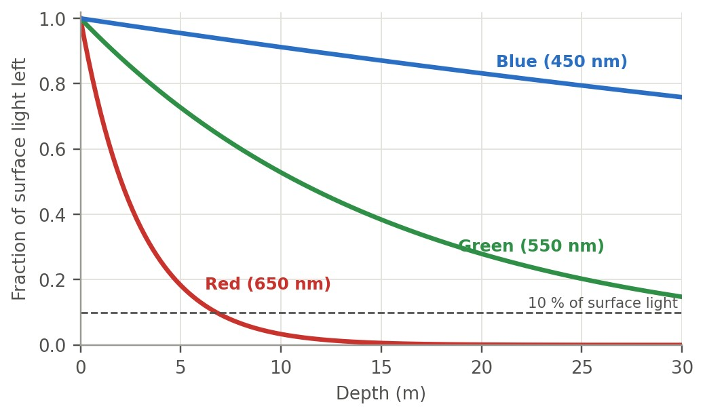
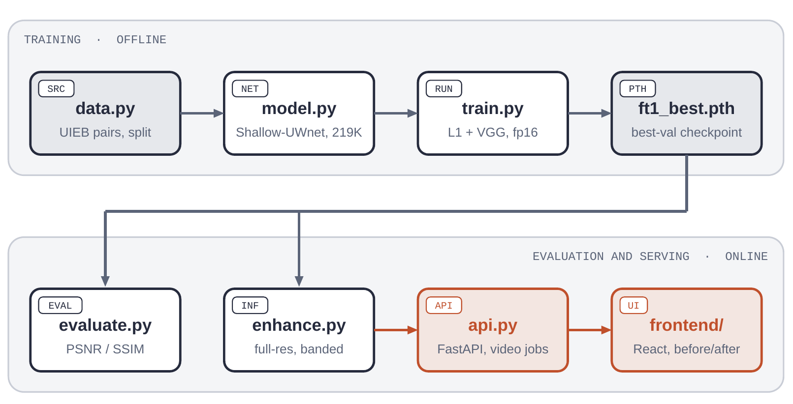
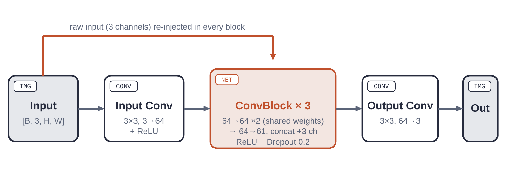
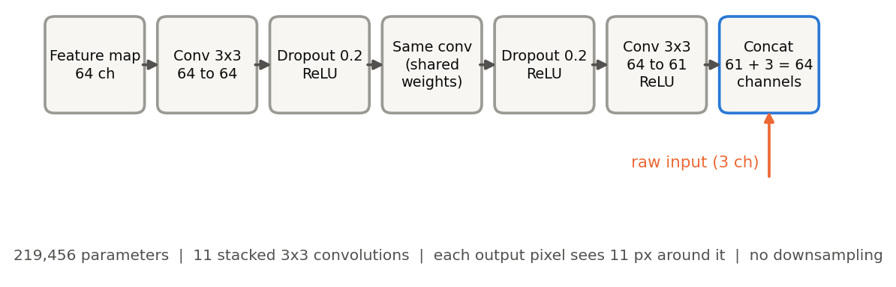
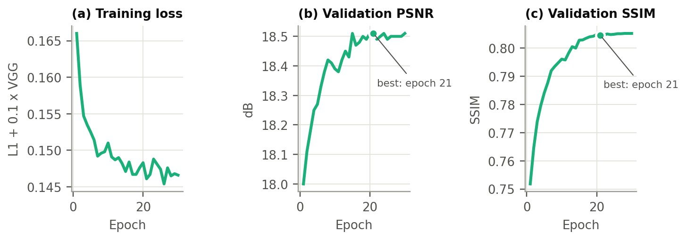
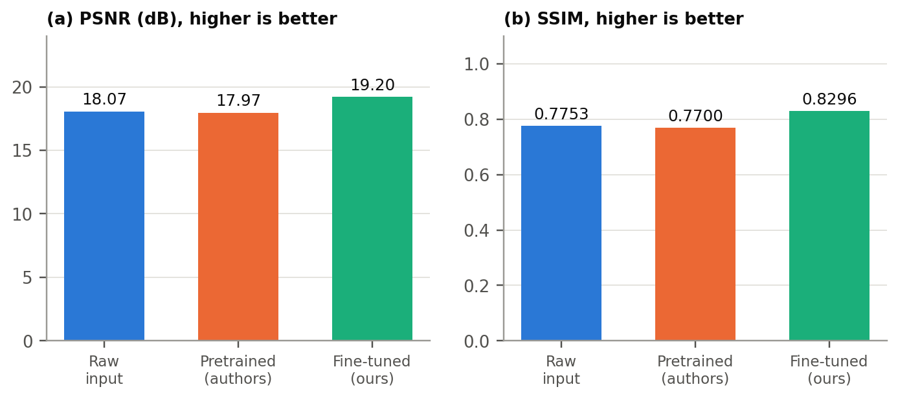
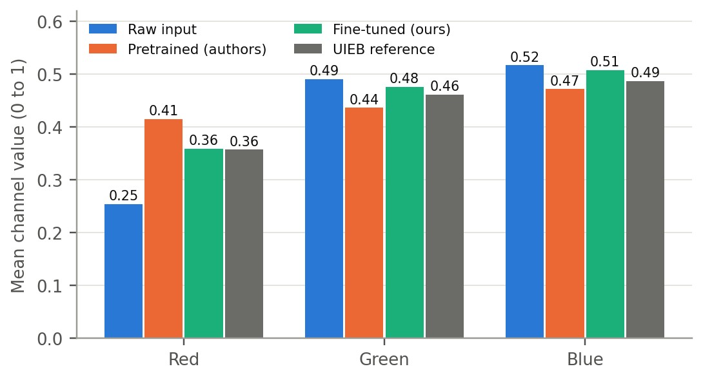
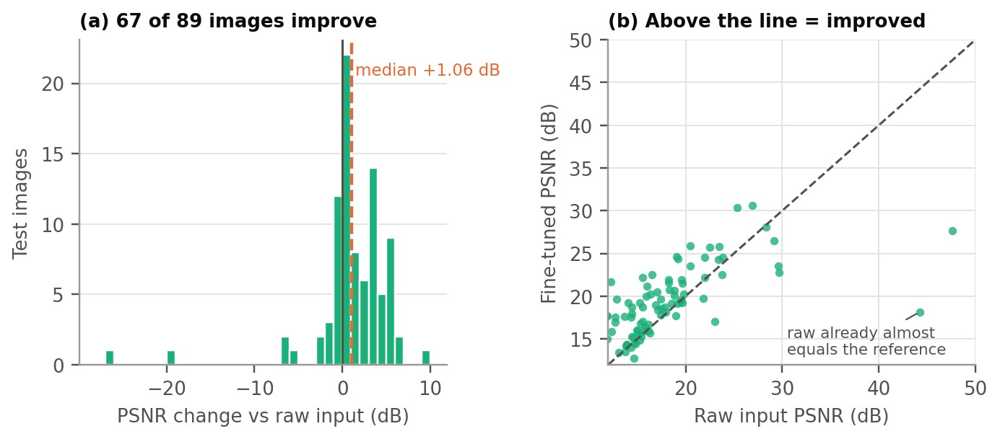
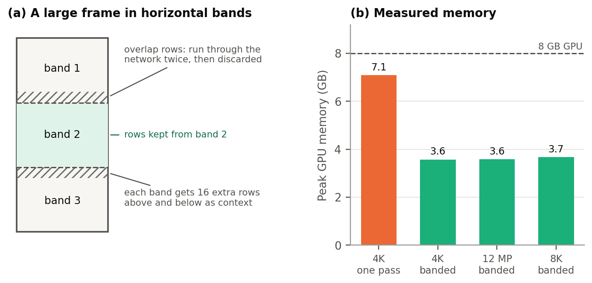

# Underwater Image Enhancement

Restore the colour and clarity of real underwater photos and video with a tiny deep network: [Shallow-UWnet](https://arxiv.org/abs/2101.02073) (219K parameters, 0.9 MB), fine-tuned on the [UIEB](https://li-chongyi.github.io/proj_benchmark.html) benchmark and served through a FastAPI backend and a React web app.


> Mini project for the AI-ML MDM course, Department of Mechanical Engineering (Robotics and AI), COEP Technological University, Pune.

## Contents

[The problem](#the-problem) · [Highlights](#highlights) · [How it works](#how-it-works) · [Results](#results) · [Large frames and speed](#large-frames-and-speed) · [Web app](#web-app) · [Quick start](#quick-start) · [Usage](#usage) · [Project layout](#project-layout) · [Testing](#testing-and-reproducibility) · [Limitations](#limitations) · [References](#references) · [Author](#author)

## The problem

Water absorbs light by wavelength, following the Beer–Lambert law. Red is gone within a few metres, green within tens of metres, and blue travels farthest, so raw underwater footage looks blue-green. Scattering adds haze on top. This hurts people and the vision systems of underwater robots (ROVs, AUVs) alike, and simple brightening cannot bring the missing red back.

<p align="center"></p>

A learned enhancer maps a degraded image to a clean one directly from paired examples. The catch: underwater there is no true "clean" photo of the same scene, so UIEB's references are the best of twelve enhancement algorithms, picked by people.

## Highlights

- **Baselines first.** The raw input and the authors' pretrained weights are scored *before* any training. This showed the pretrained weights do not transfer to UIEB (they score below doing nothing), which is what justified fine-tuning.
- **+1.13 dB PSNR and +0.054 SSIM** over the raw input on 89 unseen test images, after about 15 minutes of fine-tuning on a laptop GPU. 75 % of test images improve.
- **Full-resolution inference at any size.** Large frames are processed in overlapping bands that give a result identical to a single pass, so 4K to 8K frames fit in about 3.6 GB of VRAM.
- **Photos and video.** Light temporal smoothing reduces flicker; video runs as a background job with progress reporting.
- **Reproducible.** Seeded, saved train/validation/test split; every run saves its config and git commit; 45 CPU-only tests.
- **Safe checkpoint loading.** The authors' weights are a pickled model, so they load only after a SHA-256 check and with an allowlist of classes.

## How it works

<p align="center"></p>

Each box is one module with one job, and modules talk only through plain files and function calls, so any part (for example the model) can be swapped without touching the rest.

### Model

Shallow-UWnet is fully convolutional and never changes the image size, so it takes any resolution and returns an image of the same size. The raw 3-channel input is concatenated back into the feature maps inside every ConvBlock, which gives each block direct access to the original pixels while colours are corrected. Sharing the 64→64 convolution inside a block is what keeps it at 219,456 parameters.

<p align="center"></p>
<p align="center"></p>

Eleven stacked 3×3 convolutions give every output pixel a receptive field of 11 pixels. That fact is what makes the exact banded inference below possible.

### Loss

```
L(ŷ, y) = mean|ŷ − y|  +  0.1 · mean|φ(ŷ) − φ(y)|
```

An L1 term keeps colour and structure close to the reference. A perceptual term compares VGG16 features (up to `relu3_3`, frozen, always in eval mode) and sharpens fine detail that a pixel loss blurs.

### Training recipe (run `ft1`)

| Setting | Value |
|---|---|
| Start from | Authors' Shallow-UWnet weights (SHA-256 checked) |
| Data | UIEB, 890 pairs: 712 train / 89 val / 89 test (seed 0) |
| Input | Random 256×256 crops; flips and 90° rotations only (no colour jitter: the cast is the signal) |
| Optimiser | Adam, lr 1e-4, cosine decay to 0 |
| Batch / epochs | 16 / 30 (44 steps per epoch) |
| Precision | fp16 autocast with gradient scaling (2.9 GB VRAM per step) |
| Checkpoint | Best validation PSNR, scored every epoch on full-size images |

<p align="center"></p>

Validation PSNR rises from 18.00 to 18.51 dB, mostly by epoch 15, while the validation score never falls as the training loss keeps dropping: no sign of overfitting.

## Results

Scored at full resolution on the 89 held-out UIEB test pairs, which were never used for training or for choosing the checkpoint (higher is better):

| Model | PSNR (dB) | SSIM | Images improved |
|---|---|---|---|
| Raw input (no enhancement) | 18.07 | 0.7753 | – |
| Shallow-UWnet, authors' pretrained weights | 17.97 | 0.7700 | 50 of 89 |
| **Shallow-UWnet, fine-tuned here on UIEB** | **19.20** | **0.8296** | **67 of 89** |

<p align="center"></p>

- **Domain shift.** The authors' weights were trained on EUVP. On UIEB they overshoot red and push green and blue down, producing a grey-purple tint, and score slightly *below* the raw input.
- **Fine-tuning fixes it and goes further:** +1.13 dB / +0.054 SSIM over the raw input, +1.23 dB over the pretrained model. The median per-image gain is +1.06 dB, and 45 of 89 images gain more than 1 dB.
- **Red is restored.** Mean red on the test set: raw 0.254, fine-tuned 0.359, UIEB reference 0.357.

<p align="center"></p>

An average can hide a lot, so the per-image view matters:

<p align="center"></p>

The few images that lose several dB are the ones whose reference is nearly identical to the raw photo (raw PSNR 23 to 48 dB, against a typical 18 dB). The benchmark's "best enhancement" there was *no enhancement*, so any change the model makes counts as an error. The model cannot tell that an image should be left alone, which is its main failure mode.

Visually the gain is modest: the haze is gone and images are clearer and less blue, but they stay more conservative than UIEB's bright, saturated references. (Sample images are not included here because UIEB may not be redistributed.)

## Large frames and speed

Memory grows with pixel count, and a 4K frame in a single pass needs 7.1 GB of an 8 GB card. Because the receptive field is 11 pixels, a frame can be cut into horizontal bands, each padded with 16 rows of context (more than the 11-pixel reach), and only the central rows kept. The result is bit-for-bit identical to a single pass (a test checks this, and also checks that a 10-row overlap is caught as wrong), and peak memory stays at about 3.6 GB from 4K to 8K.

<p align="center"></p>

Measured on an RTX 4060 Laptop GPU (single measurements):

| Task | Time | Peak GPU memory |
|---|---|---|
| Training step (16 crops of 256×256, fp16, VGG loss) | 335 ms | 2.9 GB |
| Full fine-tuning run (30 epochs) | 14.5 min | – |
| 4K photo, one pass | 1.05 s | 7.1 GB |
| 4K photo, banded | 0.84 s | 3.6 GB |
| 12-megapixel photo, banded | 1.06 s | 3.6 GB |
| 8K frame, banded | 3.04 s | 3.7 GB |

## Web app

**Deep Restore** is a React + TypeScript + Tailwind v4 front end for the FastAPI backend: drag in a photo or video, pick a model, and get a draggable before/after slider (photos) or synced side-by-side players (video), plus a download button. Models offered are the authors' pretrained one and every `checkpoints/*_best.pth` found on disk; loaded models are cached and reloaded when a checkpoint is rewritten.

| Endpoint | Purpose |
|---|---|
| `GET /api/models` | List available models |
| `POST /api/enhance/photo` | Enhance a photo within one request, returns PNG |
| `POST /api/enhance/video` | Start a background video job, returns a `job_id` |
| `GET /api/enhance/video/{job_id}` | Poll status and per-frame progress |
| `GET /api/enhance/video/{job_id}/result` | Download the H.264 MP4 once the job is done |

Video runs as a polled job because a clip can take far longer than an HTTP request should wait; the result is re-encoded to H.264 so browsers can play it. See [`frontend/README.md`](frontend/README.md) for the front-end layout.

## Quick start

```bash
git clone https://github.com/Bhavik-03/Image-Enhancement.git && cd Image-Enhancement
python3 -m venv .venv && source .venv/bin/activate && pip install -r requirements.txt
python -c "import torch; print(torch.cuda.is_available())"
```

Requires Python 3.10 and, for reasonable speed, an NVIDIA GPU (the project was built on an 8 GB RTX 4060 Laptop). `source .venv/bin/activate` must be run in every new shell; on the author's setup it also puts the venv's NVIDIA libraries on `LD_LIBRARY_PATH` (see `CLAUDE.md`), without which every GPU convolution fails with a cuDNN error even though `torch.cuda.is_available()` is true.

**Data** is not in the repo: UIEB is for non-commercial use and may not be redistributed. Download the raw and reference archives from the [authors' page](https://li-chongyi.github.io/proj_benchmark.html), extract them (the page lists the archive passwords) and arrange them as:

```
data/uieb/raw/<name>.png     data/uieb/ref/<name>.png     (same file names)
```

**Pretrained weights.** Download `model.ckpt` from the [Shallow-UWnet repo](https://github.com/mkartik/Shallow-UWnet) to `data/downloads/shallow_uwnet.ckpt`. It is a pickled model, so it is loaded only through `model.load_pretrained(path, sha256=...)`; never open it with `torch.load(weights_only=False)`.

## Usage

```bash
# 1. Baselines: raw input vs the authors' pretrained weights
python evaluate.py --data data/uieb --split test --run baseline

# 2. Fine-tune (best weights -> checkpoints/ft1_best.pth, logs -> results/ft1/)
python train.py --data data/uieb --run ft1 --epochs 30

# 3. Score the fine-tuned model on the held-out test split
python evaluate.py --data data/uieb --split test --checkpoint checkpoints/ft1_best.pth --run ft1_test

# 4. Enhance your own photo or video at full resolution
python enhance.py photo.jpg --checkpoint checkpoints/ft1_best.pth
python enhance.py clip.mp4  --checkpoint checkpoints/ft1_best.pth --smooth 0.3
```

- `train.py` refuses to reuse a run name and saves its config (including the git commit) and a per-epoch log to `results/<run>/`. If the GPU runs out of memory, pass `--batch-size 8`.
- `evaluate.py` writes `results/<run>/metrics.json` and raw | enhanced | reference strips for the first images.
- `enhance.py` works at full resolution; frames over 4 megapixels are processed in overlapping bands.

**Run the web app** (one port, API plus built front end):

```bash
npm --prefix frontend install
npm --prefix frontend run build
python api.py                      # http://127.0.0.1:8000
```

**Develop the front end** with hot reload (two terminals; Vite proxies `/api/*` to the backend):

```bash
uvicorn api:app --reload           # terminal 1, from the repo root
npm --prefix frontend run dev      # terminal 2, http://localhost:5173
```

## Project layout

```
.
├── data.py            paired UIEB loader, validation, seeded split, crops and augmentation
├── model.py           Shallow-UWnet and the safe (SHA-256 + allowlist) checkpoint loader
├── losses.py          L1 + frozen-VGG16 perceptual loss
├── train.py           fine-tuning loop: fp16, cosine lr, best-by-PSNR checkpoint, run bookkeeping
├── evaluate.py        PSNR / SSIM against baselines, metrics.json, comparison strips
├── enhance.py         photo and video inference, exact banded processing, temporal smoothing
├── api.py             FastAPI backend (photo endpoint, background video jobs, serves the UI)
├── frontend/          React + TypeScript + Tailwind v4 web app ("Deep Restore")
├── tests/             45 CPU-only tests, one file per module
├── docs/images/       diagrams and plots used in this README
├── requirements.txt
└── CLAUDE.md          project notes and conventions

gitignored: data/  checkpoints/  results/  .venv/
```

## Testing and reproducibility

```bash
python -m pytest -q
```

45 tests run on the CPU in a few seconds with no network and no real dataset, using small synthetic images. They check behaviour, not just execution: PSNR is compared with its closed-form value, banding must match a single pass bit for bit, two runs with the same seed must give identical histories, and unsafe checkpoints (wrong hash, foreign classes) must be rejected.

Reproducibility choices: fixed seed 0 for Python, NumPy, PyTorch and the data loader; a train/validation/test split saved to a file and reused by every experiment; each run's arguments and git commit written next to its results; the checkpoint chosen on validation data and the final numbers reported only on the separate test split.

Development follows one feature branch per step, merged through pull requests with Conventional Commits. Data, checkpoints and results are never committed.

## Limitations

- **Small model, small data.** 219K parameters and 712 training images limit what it can restore; it does not reach the references' colour strength.
- **References are not ground truth.** PSNR and SSIM measure similarity to a human-chosen reference, not true scene colour. No-reference metrics (UIQM, UCIQE) are not computed.
- **One run.** A single seed and split on an 89-image test set gives a rough estimate with no confidence intervals. EUVP was not used for fine-tuning, so other cameras, depths and water types are untested.
- **It cannot leave an image alone.** It applies the average correction even where the reference is unchanged.
- **Video.** Frames are enhanced independently and lightly blended with the previous output. Temporal consistency was tested only on synthetic clips, with no quantitative flicker measure.
- **Web app.** The API is covered by tests; the browser UI has no automated end-to-end test.

## References

1. A. Naik, A. Swarnakar, K. Mittal. *Shallow-UWnet: Compressed Model for Underwater Image Enhancement.* AAAI 2021. [arXiv:2101.02073](https://arxiv.org/abs/2101.02073)
2. C. Li et al. *An Underwater Image Enhancement Benchmark Dataset and Beyond* (UIEB). IEEE TIP 2020. [arXiv:1901.05495](https://arxiv.org/abs/1901.05495)
3. M. J. Islam, Y. Xia, J. Sattar. *Fast Underwater Image Enhancement for Improved Visual Perception* (EUVP). IEEE RA-L 2020. [arXiv:1903.09766](https://arxiv.org/abs/1903.09766)
4. J. Johnson, A. Alahi, L. Fei-Fei. *Perceptual Losses for Real-Time Style Transfer and Super-Resolution.* ECCV 2016.
5. K. Simonyan, A. Zisserman. *Very Deep Convolutional Networks for Large-Scale Image Recognition.* ICLR 2015. [arXiv:1409.1556](https://arxiv.org/abs/1409.1556)

## Author

Built by Bhavik Fulfagar as a mini project at COEP Technological University, Pune. Thanks to the authors of Shallow-UWnet and UIEB for openly sharing their model, code and data. UIEB is licensed for non-commercial use only.
